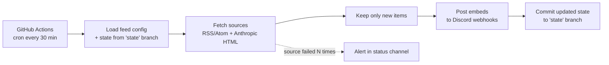

# ai-news-bot

A scheduled job, written in C#/.NET, that posts relevant AI news to Discord. It runs on GitHub Actions,
costs nothing, and is designed not to fail silently.

> **Status:** early scaffold. The solution structure and tooling are in place; the v1 features below
> are not implemented yet.

## Why

- Stay up to date on AI without hunting for news.
- Daily reading practice in technical English, at the source, untranslated.
- A public project that shows engineering decisions: scheduling, state, resilience, tests, CI.

## How it works



Each run processes everything since the previous one, so a delayed or skipped run loses nothing and
duplicates nothing. The first run only records existing items instead of posting them.

## v1 scope

- RSS/Atom feeds listed in a config file, plus a custom collector for Anthropic's news page.
- One Discord embed per new item, routed to a channel by key (`summary`, `official`, `status`).
- Deduplication, per-run post limits and Discord rate-limit handling.
- Failure alerts in a status channel.

Out of scope for now: LLM summaries or translation, AI relevance filtering, interactive commands.

## Project layout

| Path | Purpose |
| --- | --- |
| `src/AiNewsBot` | Console app, the job entrypoint |
| `src/AiNewsBot.Core` | Models, source interfaces, deduplication and rules (no dependencies) |
| `src/AiNewsBot.Infrastructure` | RSS, HTML collector, Discord client, state storage |
| `tests/` | Unit tests driven by saved fixtures, no network |

## Getting started

Prerequisites: [.NET 10 SDK](https://dotnet.microsoft.com/download) and Git.

```bash
git clone https://github.com/guinog29/ai-news-bot.git
cd ai-news-bot
dotnet build AiNewsBot.slnx
dotnet test AiNewsBot.slnx
```

## Configuration

Discord webhook URLs are read from environment variables named `DISCORD_WEBHOOK_<KEY>`, one per channel
key: `DISCORD_WEBHOOK_SUMMARY`, `DISCORD_WEBHOOK_OFFICIAL` and `DISCORD_WEBHOOK_STATUS`. In GitHub they
are stored as repository secrets. They are never committed or logged.

## Documentation

- [`docs/decisions.md`](docs/decisions.md): design decisions and their rationale.
- [`CLAUDE.md`](CLAUDE.md): architecture, commands and conventions for contributors and AI assistants.

## License

[MIT](LICENSE)
