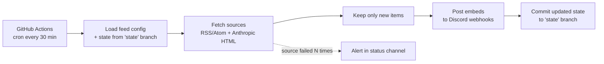

# ai-news-bot

A scheduled job, written in C#/.NET, that posts relevant AI news to Discord. It runs on GitHub Actions,
costs nothing, and is designed not to fail silently.

> **Status:** v1 is implemented and unit-tested. It has not yet run in production: the first scheduled
> run will only seed its state, and real posts start with the one after it.

## Why

- Stay up to date on AI without hunting for news.
- Daily reading practice in technical English, at the source, untranslated.
- A public project that shows engineering decisions: scheduling, state, resilience, tests, CI.

## How it works



Each run processes everything since the previous one, so a delayed or skipped run loses nothing and
duplicates nothing. A source with no state yet is only recorded, never posted, so the first run does
not flood the channels.

## What it does

- Reads RSS/Atom feeds listed in [`config/feeds.json`](config/feeds.json), plus a custom collector for
  Anthropic's news page (it has no feed).
- Posts one Discord embed per new item (title, link, source, date), routed to a channel by key.
- Deduplicates by GUID or normalized URL, caps posts per source per run, and honors Discord rate limits.
- Isolates failures: one broken source does not stop the others. After several failed runs in a row it
  alerts in a status channel, and again when the source recovers. A source that suddenly returns zero
  items counts as broken.
- Stores its state as JSON on a dedicated `state` branch, so the history of `main` stays clean.

Out of scope for now: LLM summaries or translation, AI relevance filtering, interactive commands.

## Project layout

| Path | Purpose |
| --- | --- |
| `src/AiNewsBot` | Console app: arguments, wiring, exit code |
| `src/AiNewsBot.Core` | Models, interfaces, deduplication and the job runner (no project dependencies) |
| `src/AiNewsBot.Infrastructure` | RSS, HTML collector, Discord client, config and state storage |
| `tests/` | Unit tests driven by saved fixtures and fakes, no network |
| `config/feeds.json` | Sources and limits (no secrets) |
| `.github/workflows` | `ci.yml`, `run.yml` (the scheduled job), `keepalive.yml` |

## Getting started

Prerequisites: [.NET 10 SDK](https://dotnet.microsoft.com/download) and Git.

```bash
git clone https://github.com/guinog29/ai-news-bot.git
cd ai-news-bot
dotnet build AiNewsBot.slnx
dotnet test AiNewsBot.slnx
```

Check that every configured source can be read right now, without posting or storing anything:

```bash
dotnet run --project src/AiNewsBot -- --dry-run
```

## Configuration

**Sources and limits** live in [`config/feeds.json`](config/feeds.json). Each source has a name, a
channel key, a type (`rss` or `anthropic-news`) and an https URL. The `options` block sets the limits
(window of items considered, items remembered, posts per run, failures before alerting).

**Webhooks** are read from environment variables named `DISCORD_WEBHOOK_<KEY>` for each channel key:
`DISCORD_WEBHOOK_SUMMARY`, `DISCORD_WEBHOOK_OFFICIAL` and `DISCORD_WEBHOOK_STATUS`. In GitHub they are
repository secrets. They are never committed or logged. Without the status webhook the bot still runs,
but sends no alerts.

**Adding a channel** needs no code: pick a key, create the webhook, add the secret
`DISCORD_WEBHOOK_<KEY>`, expose it to the `Run` workflow's `env`, and use the key in the config.

## Deployment

1. Add the three webhook secrets to the repository.
2. Merge to `main` and run the **Run** workflow once by hand. It creates the `state` branch and seeds it
   without posting anything.
3. From then on the cron (`17,47 * * * *`) posts what is new. The **Keepalive** workflow re-enables the
   schedules monthly so GitHub does not disable them after 60 days of inactivity.

## Documentation

- [`docs/decisions.md`](docs/decisions.md): design decisions and their rationale.
- [`CLAUDE.md`](CLAUDE.md): architecture, commands and conventions for contributors and AI assistants.

## License

[MIT](LICENSE)
